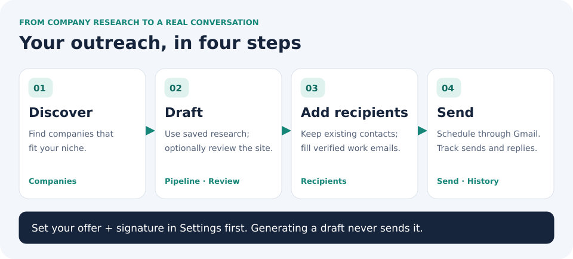
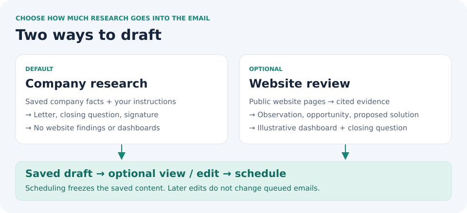
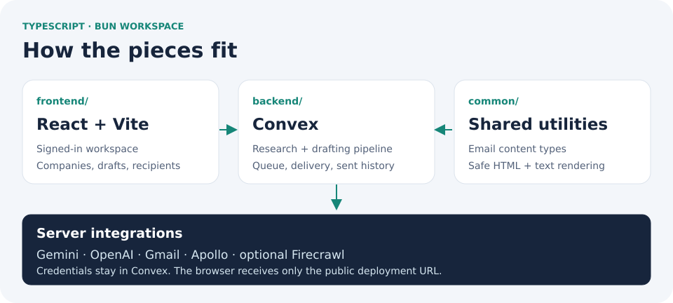

# ColdOutreach

Find companies, draft personalized outreach, and send through Gmail.







## Run locally

Requires [Bun](https://bun.sh) ≥ 1.2 and access to the **`jp-mak/coldoutreach`**
Convex project. [Configure server keys and sign-in first →](docs/guide.md#server-side-integration-settings)

```bash
bun install --frozen-lockfile
cp backend/.env.example backend/.env.local
cp frontend/.env.example frontend/.env.local
bun run setup:backend
bun run app
```

Deploy only to **ColdOutreach**. Run Convex CLI commands from `backend/`.
Keep credentials in Convex; the frontend needs only `VITE_CONVEX_URL`.

## Details when you need them

| Need                                        | Guide                                                       |
| ------------------------------------------- | ----------------------------------------------------------- |
| App walkthrough                             | [Using the app](docs/guide.md#using-the-app)                |
| Keys, sign-in, or a new deployment          | [Setup](docs/guide.md#isolated-coldoutreach-backend)        |
| Apollo contacts                             | [Recipient enrichment](docs/apollo-recipient-enrichment.md) |
| Delivery, retries, and duplicate protection | [Sending semantics](docs/guide.md#sending-semantics)        |
| Website evidence and safe rendering         | [Safeguards](docs/guide.md#website-review-safeguards)       |
| Tests and code organization                 | [Development guide](docs/guide.md#quality-checks)           |

```bash
bun run test
bun run lint
bun run typecheck
bun run build
```
